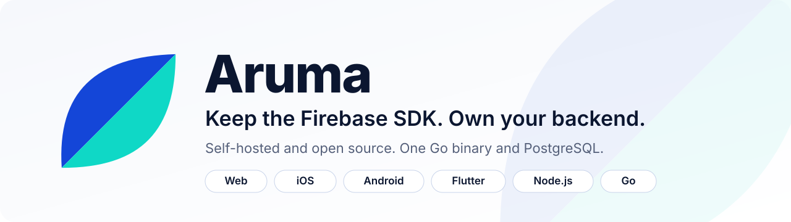
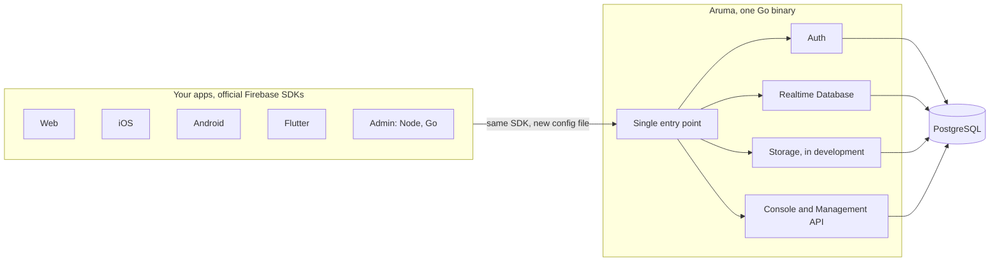
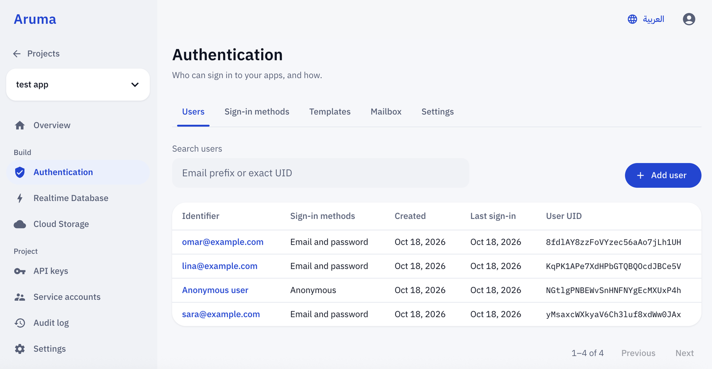
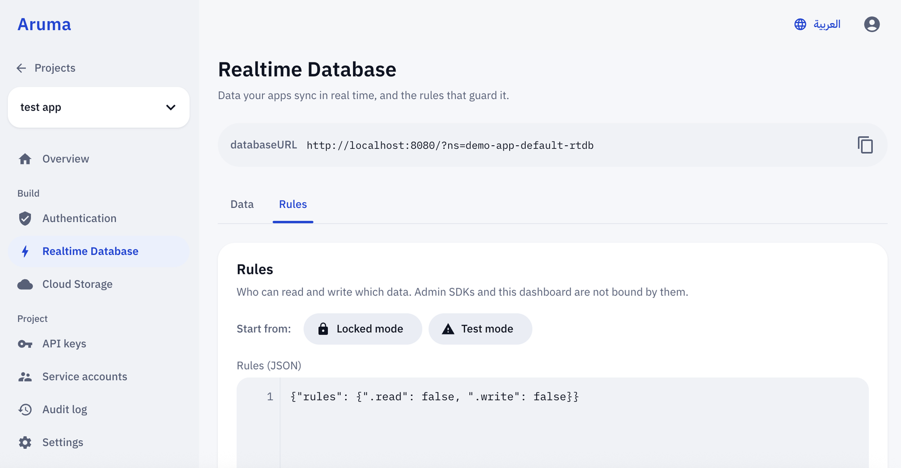
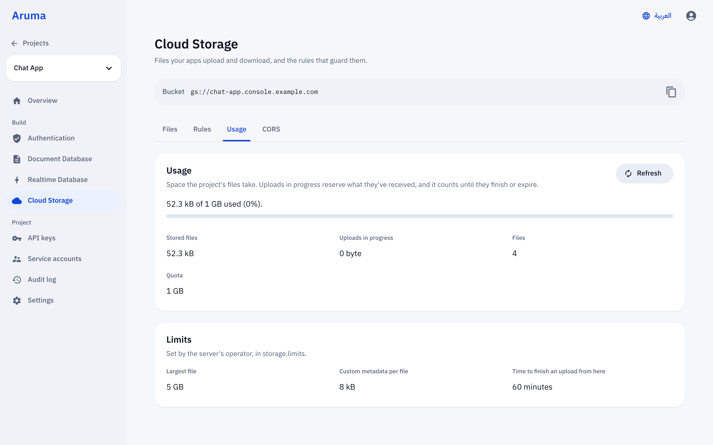

<div align="center">

<picture>
  <source media="(prefers-color-scheme: dark)" srcset="docs/assets/banner-dark.svg">
  
</picture>

<br>

**A self-hosted backend that speaks the official Firebase SDKs.**
One Go binary and PostgreSQL. Your apps keep the official SDKs and your application code does not change.

<br>

[](LICENSE)
[](go.mod)
[](#quick-start)
[](#status)

[English](README.md) · [العربية](README.ar.md)

[Quick start](#quick-start) · [Status](#status) · [How it works](#how-it-works) · [Configuration](docs/configuration.md) · [Docs](#documentation) · [Contributing](CONTRIBUTING.md)

</div>

<br>

## Why Aruma

Firebase gives you excellent client SDKs and a managed backend you can't leave. Aruma keeps the first part and replaces the second.

- **Keep the official SDKs.** Web, iOS, Android, Flutter and the Admin SDKs run in their normal production mode, with no emulator mode. You swap the configuration file, and on some platforms add one line of build configuration (see [`sdk/`](sdk)). Your application code stays the same.
- **Own your data.** Run it on a cheap VPS, on your own servers, or wherever PostgreSQL runs. One binary, one database, no per-operation billing.
- **Open source.** Apache 2.0. Read the code, run the tests, send a patch.
- **Built to be verified.** Behavior is checked against real Firebase and the official emulators, and the official Firebase test suites are run against Aruma. See [Status](#status) for the numbers.

> Aruma is not affiliated with or endorsed by Google. Firebase is a trademark of Google LLC.

## Status

Aruma is pre-1.0 and under active development. Services land one at a time, each closed with a compatibility report before the next one starts.

| Service | State | Evidence |
|---|---|---|
| **Platform**: projects, apps, API keys, service accounts, console, Management API | Available | Acceptance tests, project-isolation tests in CI, the `firebase` CLI works against it |
| **Authentication** | Released in [v0.1.0](docs/compat/auth-v0.1.md) | 27/27 P0 scenarios, 180 passing official Firebase JS Auth tests, Web, iOS, Android and Node verified |
| **Realtime Database** | Released in [v0.2.0](docs/compat/rtdb-v0.2.md), opt-in with `ARUMA_RTDB_ENABLED` | 332/332 official Firebase RTDB tests against a production-style `databaseURL` |
| **Security Rules** and **Cloud Storage** | In development for v0.3 ([storage](docs/compat/storage-v0.3.md), [rules](docs/compat/rules-v0.3.md)) | Official Storage suites and iOS, Android and Web production paths in progress |
| **Firestore** | Planned | |
| **Cloud Messaging, App Check, Remote Config, Functions** | Planned, after the core services | |

Every difference from Firebase is documented, with its source and classification, in the compatibility reports under [`docs/compat`](docs/compat) and the [architecture decisions](docs/adr).

## How it works



1. Create a project and an app from the console or with `arumactl`.
2. Download the app's configuration file (`google-services.json`, `GoogleService-Info.plist`, or the Web and Flutter equivalents).
3. Put it in your app in place of the Firebase one. Your application code does not change. Where a platform needs it, add the one build line described in [`sdk/`](sdk).

Projects are isolated from each other, enforced by PostgreSQL row-level security and tested in CI. The design is in [ADR-008](docs/adr/ADR-008-single-entry.md), [ADR-015](docs/adr/ADR-015-services-layout.md) and [ADR-017](docs/adr/ADR-017-postgres-rls.md).

## The console

Every Aruma server ships with a console, embedded in the same binary. Create projects and apps, manage users, edit rules, browse data and files, and download the configuration files your apps need.

<p align="center">
  
</p>

<table>
  <tr>
    <td width="50%"></td>
    <td width="50%"></td>
  </tr>
</table>

The console is in English and Arabic (right to left).

## Quick start

Requirements: Go 1.26+, PostgreSQL 18 (for example through [DBngin](https://dbngin.com) or [Postgres.app](https://postgresapp.com)), and Node 24 to build the console.

```bash
make dashboard   # build the console and embed it in the binary (once)
make dev         # create .env with a random key on first run, then the database, migrations and the server
```

Open <http://localhost:8080>. The first start prints a one-time setup `code` in the log. Enter it on the setup page to create your first account.

If the Postgres tools are not on your `PATH`, set `ARUMA_PG_BIN`, for example `ARUMA_PG_BIN=/Users/Shared/DBngin/postgresql/18.1/bin`.

### Configure a server

Three settings are required. Everything else has a default.

| Variable | Meaning |
|---|---|
| `ARUMA_DATABASE_URL` | PostgreSQL connection URL |
| `ARUMA_PUBLIC_URL` | The address your SDKs reach, for example `https://aruma.example.com` |
| `ARUMA_MASTER_KEY` | 32 random bytes in base64 (`openssl rand -base64 32`). All other keys are derived from it |

Configuration is an optional YAML file (`--config` or `ARUMA_CONFIG`) with `ARUMA_*` environment variables taking precedence. The full reference is in [docs/configuration.md](docs/configuration.md), and [`aruma.example.yaml`](aruma.example.yaml) shows every key.

### Operate it

```bash
aruma migrate up|status                 # the server never runs DDL and refuses to start on an old schema
aruma serve
aruma accounts create --email you@example.com
aruma backup --out aruma.dump           # pg_dump, custom format
aruma restore --in aruma.dump --yes     # with the server stopped, in a single transaction
aruma config check
```

### Use it from the command line

Create a CLI token in the console (My account, CLI tokens), then:

```bash
arumactl login --server https://aruma.example.com
arumactl projects create chat-app --name "Chat App"
arumactl apps create --project chat-app --platform android --package com.example.chat
arumactl apps sdkconfig --project chat-app <APP_ID> --out .
arumactl sa create --project chat-app backend
arumactl sa keys create --project chat-app backend@chat-app.sa.aruma.example.com --out key.json
```

The official `firebase` tool works too, through `FIREBASE_API_URL`, `FIREBASE_TOKEN_URL` and `FIREBASE_TOKEN`. Details are in [docs/research/experiments.md](docs/research/experiments.md).

## Repository layout

| Path | What lives there |
|---|---|
| `cmd/aruma`, `cmd/arumactl` | The server and the developer CLI |
| `internal/server` | The single public entry point: path routing and security headers |
| `internal/services` | `auth`, `rtdb` and `storage` |
| `internal/admin` | The console backend, the Management API and OAuth tokens |
| `internal/tenancy` | Platform logic, ownership gate and generated queries (sqlc) |
| `internal/store` | Connections, transactions, migrations and backups |
| `internal/platform` | Shared building blocks: errors, authn, crypto, HTTP, logging, metrics, rate limiting |
| `dashboard/` | The console: Next.js, static export, Arabic RTL by default |
| `sdk/` | Small packages that point the official SDKs at Aruma: Web, iOS, Android, Go and Node |
| `test/` | Acceptance, isolation, compatibility, oracle and smoke tests |
| `docs/` | Architecture decisions, compatibility reports, security reviews and research |

The package dependency rule is enforced by a test in CI.

## Testing

```bash
make test    # unit, acceptance and isolation tests (needs a local Postgres; each test gets a fresh database)
make lint    # gofmt, vet and the dependency rules
make smoke   # the official SDKs against real config files: web, admin-node, admin-go, android, ios, flutter
```

## Security

- No default account. The first one needs a one-time code from the log, and sign-up is closed by default.
- Passwords use argon2id. Tokens are stored as HMACs only, and a service account's private key is never stored.
- What a caller does not own returns `NOT_FOUND`.

The full list and its tests are in [ADR-010](docs/adr/ADR-010-secure-defaults.md) and the [threat model](docs/security/threat-model.md). To report a vulnerability, read [SECURITY.md](SECURITY.md).

## Documentation

- [Architecture decisions](docs/adr/README.md)
- [Compatibility reports](docs/compat)
- [Guides](docs/guides): Web auth, Admin auth, Realtime Database and operating it
- [Security reviews](docs/security)
- [Performance baselines](docs/performance)
- [Research notes](docs/research)

## Contributing

Issues and pull requests are welcome. Start with [CONTRIBUTING.md](CONTRIBUTING.md).

## License

Apache License 2.0, see [LICENSE](LICENSE) and [NOTICE](NOTICE). Firebase is a trademark of Google LLC. Aruma is not affiliated with Google and is not endorsed by it.
