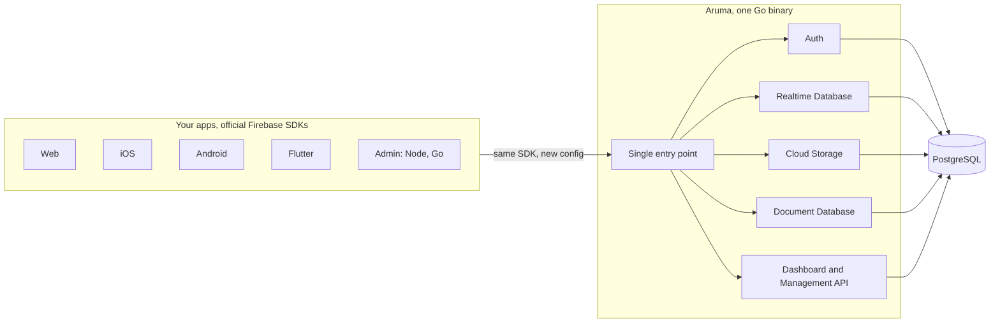

<div align="center">

<picture>
  <source media="(prefers-color-scheme: dark)" srcset="docs/assets/banner-dark.svg">
  
</picture>

<br>

**A self-hosted backend that speaks the official Firebase SDKs.**
One Go binary and PostgreSQL. Your apps keep the official SDKs.

<br>

[](LICENSE)
[](go.mod)
[](#quick-start)
[](#status)

[Quick start](#quick-start) · [Status](#status) · [Docs](docs/README.md) · [SDK packages](docs/sdks.md) · [Contributing](CONTRIBUTING.md)

</div>

<br>

## What Aruma is

Aruma is a self-hosted replacement for Firebase. It is one Go binary with PostgreSQL and an embedded Next.js dashboard. It serves Firebase Auth, Realtime Database, Cloud Storage, Security Rules and the Document Database (Firestore-compatible) to the official Firebase SDKs, so you change a config file and not your application code.

It is for developers and teams who use Firebase and want to run the backend themselves, on a small VPS or on their own servers, with their data in a PostgreSQL they control.

Behavior is checked against real Firebase and the official emulators, and the official Firebase test suites run against Aruma. Every difference is documented in [known differences](docs/reference/known-differences.md).

## Status

Aruma is pre-1.0. The latest release is [v0.3.0](docs/CHANGELOG.md#v030). The Document Database is in the release candidate [v0.4.0-rc.1](docs/CHANGELOG.md#v040-rc1); some of its verification is still pending.

| Service | Status | Details |
|---|---|---|
| Platform: projects, apps, API keys, service accounts, dashboard, Management API | Released | [Architecture](docs/architecture.md) |
| Authentication | Released in v0.1.0 | [Compatibility](docs/reference/compatibility.md#auth), [web guide](docs/guides/auth-web.md), [Admin guide](docs/guides/auth-admin.md) |
| Realtime Database | Released in v0.2.0, off by default (`ARUMA_RTDB_ENABLED`) | [Compatibility](docs/reference/compatibility.md#realtime-database), [guide](docs/guides/realtime-database.md) |
| Security Rules | Released in v0.3.0 | [Compatibility](docs/reference/compatibility.md#security-rules) |
| Cloud Storage | Released in v0.3.0, off by default (`ARUMA_STORAGE_ENABLED`) | [Compatibility](docs/reference/compatibility.md#cloud-storage) |
| Document Database (Firestore-compatible) | Release candidate v0.4.0-rc.1, off by default (`ARUMA_DOCUMENTS_ENABLED`) | [Compatibility](docs/reference/compatibility.md#firestore), [migration guide](docs/guides/firestore-migration.md) |
| Cloud Messaging, App Check, Remote Config, Functions | Planned | |

## Quick start

You need Go 1.26+, PostgreSQL 18 and Node 24 (to build the dashboard).

```bash
git clone https://github.com/arumadev/aruma.git && cd aruma
make dashboard   # 1. build the dashboard and embed it in the binary (once)
make dev         # 2. create .env with a random key, the database, migrations, and start the server
```

3. Open <http://localhost:8080>. The first start prints a one-time setup `code` in the log. Enter it to create your first account, then create a project and an app and copy the config file.

[Getting started](docs/getting-started.md) goes on from here: running the binary on a server, creating a project and an app, and signing a user in from a web app. Settings are in [configuration](docs/reference/configuration.md).

## How apps connect

Your app keeps the official SDK and takes the config file from Aruma. Where a platform has Google's hosts compiled in, a small package under [`sdk/`](sdk) points the SDK at your server with one line of build or manifest configuration. The packages and what each one does are in [SDK packages](docs/sdks.md).



Projects are kept apart by a `project_number` that is the first column of every key in every data table. Every query on a project table takes it as a condition, and a CI test checks this. Aruma does not use PostgreSQL row-level security. See [architecture](docs/architecture.md#tenancy).

## The dashboard

Every Aruma server ships with a dashboard, embedded in the same binary. Create projects and apps, manage users, edit rules, browse data and files, and download the config files your apps need.

<p align="center">
  
</p>

<table>
  <tr>
    <td width="50%"></td>
    <td width="50%"></td>
  </tr>
</table>

## Documentation

- [Getting started](docs/getting-started.md)
- [Documentation index](docs/README.md)
- Guides: [web Auth](docs/guides/auth-web.md), [Admin Auth](docs/guides/auth-admin.md), [Realtime Database](docs/guides/realtime-database.md), [Firestore migration](docs/guides/firestore-migration.md), [operations](docs/guides/operations.md)
- Reference: [configuration](docs/reference/configuration.md), [compatibility](docs/reference/compatibility.md), [known differences](docs/reference/known-differences.md), [console API](docs/reference/console-api.md)
- [Architecture](docs/architecture.md), [security](docs/security.md), [testing](docs/testing.md), [benchmarks](docs/benchmarks.md)
- [Changelog](docs/CHANGELOG.md)

To report a vulnerability, read [SECURITY.md](SECURITY.md).

## Contributing

Issues and pull requests are welcome. Start with [CONTRIBUTING.md](CONTRIBUTING.md).

## License

Apache License 2.0, see [LICENSE](LICENSE) and [NOTICE](NOTICE). Firebase is a trademark of Google LLC. Aruma is not affiliated with Google and is not endorsed by it.
