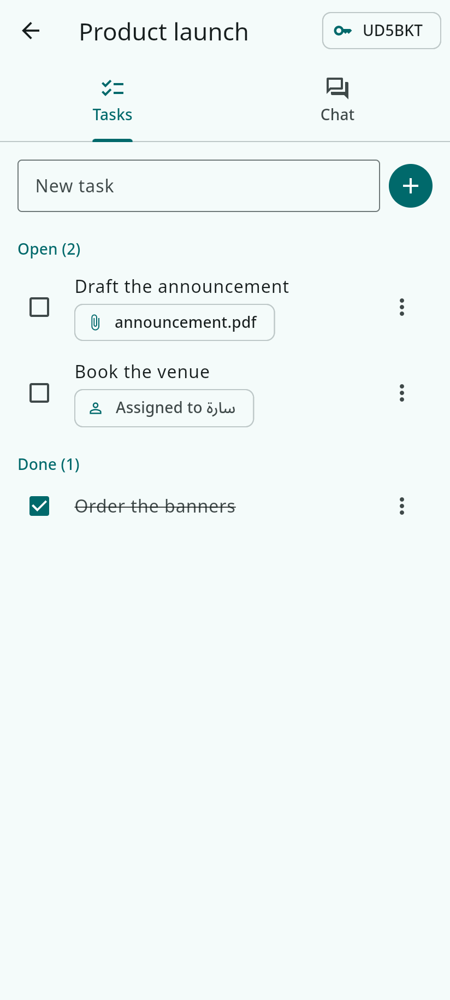
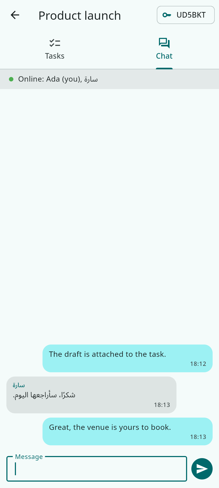
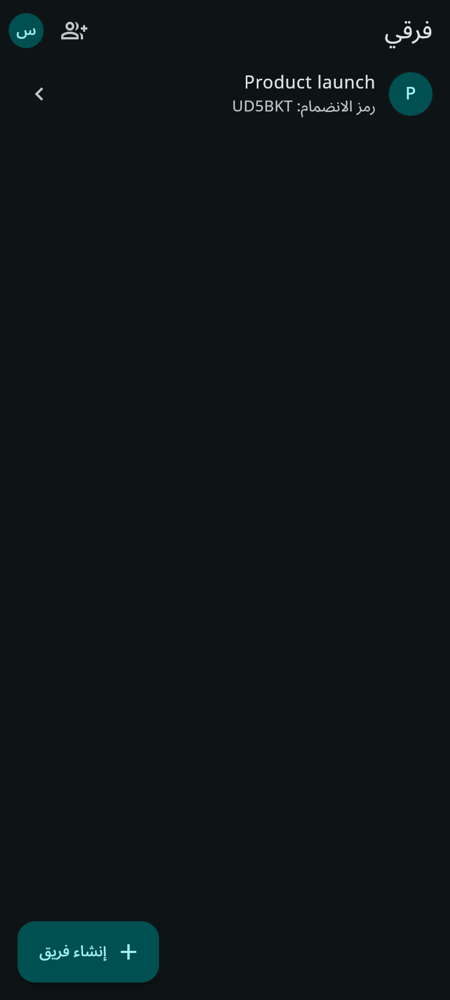

# Team Board (Flutter)

A small team app built on the **official FlutterFire plugins** (`firebase_auth`, `cloud_firestore`, `firebase_database`, `firebase_storage`) that runs against an Aruma server, or against Firebase with one switch. It is the same app, on the same data and rules, as the [web example](../web/README.md): a web client and a Flutter client of one project see each other's teams, tasks, chat and presence.

| Tasks (English, light) | Chat (English, light) | Teams (Arabic, dark) | Profile (Arabic, dark) |
|---|---|---|---|
|  |  |  |  |

All ten screenshots, made from the web build by `e2e/run.sh --screenshots`, are in [docs/](docs/).

## What the app does

- **Sign in** with email and password, **create an account**, or **continue as a guest** (anonymous sign-in). Wrong and weak passwords are shown as such.
- **My teams:** the teams you belong to. **Create** a team (it gets a six-character join code) or **join** one by its code.
- **A team, Tasks tab:** add tasks, tick them off, assign them to a member, delete them, and attach one file per task (with upload progress). Every change shows up live on every member's screen. Open tasks are listed first.
- **A team, Chat tab:** the last 50 messages, live, and who is online right now.
- **Profile:** your name, your picture, the language (English or Arabic, right to left, remembered), the theme (system, light or dark, remembered), sign out.
- Real loading, empty and error states, a "permission denied" message when a security rule refuses something, and a banner while the app is offline (the Realtime Database's `.info/connected`).

Material 3, no state-management package: `StreamBuilder`, `ChangeNotifier` and `ValueListenableBuilder`. Every listener ends with its screen.

## Prerequisites

- **Flutter 3.44.2** on the stable channel (Dart 3.12.2). This is the version CI uses.
- **Node.js 20.19 or later** for the web build step.
- **An Aruma server** with the Realtime Database, Cloud Storage and the Document Database turned on (see [getting started](../../docs/getting-started.md) and [Using Firestore with Aruma](../../docs/guides/firestore.md)), and a CLI token for it (dashboard, Account, CLI tokens).
- Android: the Android SDK (platform 36) and a JDK 17 or later. iOS: a Mac with Xcode and CocoaPods, and a hosted mirror of the patched FirebaseStorage (below).
- This repository: the example uses `sdk/flutter/aruma_storage`, `sdk/web/aruma-web`, `sdk/android/*` and `sdk/ios/ArumaRedirect` from it by relative path. If you copy the example elsewhere, change those paths (they are listed in each section).

## The two settings

Everything about your backend is in two files.

1. **`lib/firebase_options.dart`**, the file Aruma generates. The one in the repository is a placeholder: until you replace it, the app starts on a screen that says so.
2. **`aruma.json`**, the one Aruma setting:

   ```json
   {"useAruma": true, "arumaUrl": "http://127.0.0.1:8080"}
   ```

   `arumaUrl` is your server's `public_url`: the root of its host, no path. The Dart code, the Android build, the iOS build and the web build step all read this one file. `"useAruma": false` turns every Aruma line off (see [The same code on Firebase](#the-same-code-on-firebase)).

## Set up the project in Aruma

1. In the dashboard, create a project (or use one), and add three apps under it:
   - **Web.**
   - **Android**, package name `dev.aruma.examples.team_board`.
   - **iOS**, bundle ID `dev.aruma.examples.teamBoard`.
2. On the project page, in the **Flutter** card, pick those three apps and choose **Download firebase_options.dart**. Save it as `lib/firebase_options.dart`.
3. In **Authentication, Sign-in methods**, turn on **Anonymous** for the guest button. Email and password is on by default.
4. Deploy the rules and the index (next section).
5. Write your server's address into `aruma.json`.

## Deploy the rules

[`rules/`](rules/) holds the three rules files and one index file, the same files as the web example's:

| File | What it protects |
|---|---|
| [firestore.rules](rules/firestore.rules) | Profiles, teams, members and tasks |
| [database.rules.json](rules/database.rules.json) | Chat, presence, and the membership mirror they read |
| [storage.rules](rules/storage.rules) | Profile pictures and task attachments |
| [firestore.indexes.json](rules/firestore.indexes.json) | The collection-group index that "My teams" needs (`members.uid`) |

A new project is closed until you deploy them. Two ways:

**With the script in this folder** (curl and python3 only; the same HTTP calls `firebase deploy` makes; `--anonymous` also turns on guest sign-in). The end-to-end test deploys with it:

```sh
ARUMA_URL=http://127.0.0.1:8080 ARUMA_TOKEN=aruma_pat_... tool/deploy_rules.sh <project id> --anonymous
```

**With firebase-tools**, as in [Write and deploy rules](../../docs/guides/security-rules.md). `firebase.json` in this folder names the four files. The guides say to use Aruma's https address:

```sh
A=https://aruma.example.com
export FIREBASE_API_URL=$A FIREBASE_TOKEN_URL=$A FIREBASE_RULES_URL=$A \
  FIREBASE_FIREBASESTORAGE_URL=$A FIREBASE_SERVICE_USAGE_URL=$A FIRESTORE_URL=$A \
  FIREBASE_RTDB_MANAGEMENT_URL=$A FIREBASE_TOKEN=<CLI token> FIREBASE_SKIP_INFORMATIONAL_IAM=1
firebase deploy --only firestore,database,storage --project <project id>
```

You can also paste each rules file into the dashboard's Rules screens, and add the exemption on **Document Database, Indexes, Automatic**: collection group `members`, field `uid`, with the collection-group scope ascending index on.

## Run it on the web

```sh
cd examples/flutter
flutter pub get
tool/web.sh                      # once, and again after you change aruma.json or upgrade firebase_core
flutter run -d chrome            # or: flutter build web --no-web-resources-cdn
```

On the web, FlutterFire loads the Firebase JS SDK from `www.gstatic.com` at run time, so no bundler sees it. [`tool/web.sh`](tool/web.sh) does what [`@aruma/web`](../../sdk/web/aruma-web/README.md) documents for Flutter web:

1. It installs `@aruma/web` from this repository and the `firebase` npm package of the exact version `firebase_core_web` loads (12.19.0, see `package.json` and the pin in `pubspec.yaml`).
2. It runs `npx aruma-web flutter-web --url <arumaUrl> --products auth,storage,firestore`. That writes `web/aruma/` with `firebase-auth.js`, `firebase-storage.js` and `firebase-firestore.js` rewritten for your server, and a block in `web/index.html` that loads them in place of Google's copies, before the app starts. Sign-up, sign-in, the guest sign-in and token refresh then go to Aruma, as do Storage and Firestore.

`web/aruma/` names your server, so it is not committed. `web/index.html` is changed in place: run `tool/web.sh` again to change or remove the block.

`--no-web-resources-cdn` serves CanvasKit from your own site instead of Google's CDN. [`web/flutter_bootstrap.js`](web/flutter_bootstrap.js) does the same for fonts: the app bundles Noto Sans and Noto Sans Arabic, and the engine looks for its fallback fonts on your site. What still comes from Google at run time is the rest of the Firebase JS SDK (`firebase-app.js` and `firebase-database.js` from `www.gstatic.com`), as for any FlutterFire web app; neither holds a user's credentials or token on its way to Google (the Realtime Database goes to the `databaseURL` of `firebase_options.dart`).

Serve `build/web` from any static server. Profile pictures are shown through the browser's own `` when the bucket has no CORS rule (`webHtmlElementStrategy: fallback`). An attachment opens in a new tab.

## Run it on Android

The Android project is set up as [Pointing mobile apps at Aruma](../../docs/guides/mobile-apps.md) describes, line by line as the Android tests in this repository (`test/e2e/android-storage`, `test/e2e/flutter-storage`):

- `android/settings.gradle.kts` includes the builds of [`dev.aruma.storage`](../../sdk/android/aruma-storage-gradle) and [`aruma-redirect`](../../sdk/android/aruma-redirect) from this repository. Outside this repository, publish both with `./gradlew publishToMavenLocal` (see each README) and add `mavenLocal()` to the repositories instead.
- `android/app/build.gradle.kts` reads `aruma.json`. With Aruma on, it applies `dev.aruma.storage` with `arumaStorage { url = arumaUrl }` (download links point at Aruma), adds `dev.aruma:aruma-redirect:0.1.0` (Auth), and fills `ArumaURL` and `ArumaStorageRedirect=false` in `AndroidManifest.xml`. With Aruma off, none of these.
- The Firestore host is set in Dart from `aruma.json` (`lib/main.dart`).

**On an emulator, with Aruma on your computer:** use `http://127.0.0.1:8080` in `aruma.json` (the same `public_url` your server has), and forward the port into the emulator:

```sh
adb reverse tcp:8080 tcp:8080
flutter run -d emulator-5554
```

Why not `10.0.2.2`, the emulator's name for your computer? The download links and the Realtime Database URL in `firebase_options.dart` carry the server's `public_url`, so the app must reach the server under that same name. `firebase_storage` also takes `10.0.2.2` and `localhost` for its own emulator's hosts when it parses links. With `adb reverse`, `127.0.0.1` works on the emulator and on a device with USB debugging. If you do run the server with `public_url` `http://10.0.2.2:8080`, both Aruma libraries accept `http` to `10.0.2.2` in debug builds.

**Cleartext:** Android refuses `http` by default. Debug builds of this app allow it for `127.0.0.1`, `localhost` and `10.0.2.2` only (`android/app/src/debug/res/xml/network_security_config.xml`). Release builds keep Android's default.

**Properly, with HTTPS:** put Aruma behind a TLS proxy with a certificate from a public authority (gRPC needs HTTP/2 through the proxy, see [Firestore](../../docs/guides/firestore.md)), set `public_url` and `aruma.json` to `https://aruma.example.com`, and download `firebase_options.dart` again. Nothing else changes, and no cleartext setting is needed.

## Run it on iOS

Set up as the guide says for Flutter on iOS:

- **Auth:** [`ios/Podfile`](ios/Podfile) adds `pod 'ArumaRedirect', :path => '../../../sdk/ios/ArumaRedirect'` when Aruma is on (point `:path` at your clone outside this repository).
- **`ArumaURL`:** `ios/Runner/Info.plist` has the key, and the **Aruma URL** build phase ([`ios/aruma_url.sh`](ios/aruma_url.sh)) writes the value from `aruma.json` into the built app. In Release it also sets `ArumaStorageRedirect` to `false`, so an app that resolved the official FirebaseStorage stops at launch. With Aruma off it removes both keys.
- **Storage:** FlutterFire comes through Swift Package Manager (`enable-swift-package-manager` in `pubspec.yaml`), and SwiftPM must resolve firebase-ios-sdk 12.19.3 from your mirror with the patched FirebaseStorage. Build and host the mirror as [`sdk/ios/firebase-storage-patch`](../../sdk/ios/firebase-storage-patch/README.md) says, then:

  ```sh
  ios/set_mirror.sh <your mirror URL>    # writes ios/Runner.xcworkspace/xcshareddata/swiftpm/configuration/mirrors.json
  flutter run -d <simulator>
  <aruma>/sdk/ios/firebase-storage-patch/check-firebase-storage.sh   # check what SwiftPM resolved
  ```

  Commit `mirrors.json` and `Package.resolved`. The FlutterFire versions are pinned to the line that asks for firebase-ios-sdk 12.19.3, the tag the mirror has (`pubspec.yaml`).
- **The Simulator** reaches Aruma on your Mac at `http://127.0.0.1:8080` (`NSAllowsLocalNetworking` is on). A real device needs https with a certificate from a public authority.

## The same code on Firebase

1. Run `flutterfire configure` in this folder. It writes `lib/firebase_options.dart` for your Firebase project.
2. Set `{"useAruma": false}` in `aruma.json`.
3. Web: run `tool/web.sh` once. It removes the block from `web/index.html` and deletes `web/aruma/`.
4. Deploy the rules and the index to Firebase: `firebase deploy --only firestore,database,storage` (no Aruma variables), and turn on anonymous sign-in in the Firebase console.

With Aruma off, the Dart code sets no Firestore host and does not convert download links; the Android build applies no Aruma plugin or library and sets no `ArumaURL`; the Podfile adds no `ArumaRedirect`; and the iOS build phase removes `ArumaURL`. A patched FirebaseStorage from a mirror behaves exactly as the official one without `ArumaURL`, or remove `mirrors.json`.

## The data model

The same model as [the web example's](../web/README.md#the-data-model-in-short):

| Service | Path | Fields |
|---|---|---|
| Firestore | `users/{uid}` | `name`, `photoURL` (download link or null), `updatedAt` |
| Firestore | `teams/{teamId}` | `name`, `owner`, `createdAt`. The id is the join code |
| Firestore | `teams/{teamId}/members/{uid}` | `uid`, `role` (`owner` or `member`), `name`, `joinedAt` |
| Firestore | `teams/{teamId}/tasks/{taskId}` | `title`, `done`, `assignee`, `createdBy`, `createdAt`, `updatedAt`, `attachment` (`{name, path}` or null) |
| Realtime Database | `members/{teamId}/{uid}` | `true`: the membership, mirrored for the database's rules |
| Realtime Database | `chat/{teamId}/messages/{pushId}` | `uid`, `name`, `text`, `ts` (server time) |
| Realtime Database | `presence/{teamId}/{uid}` | `name`, `online`, `lastSeen`; removed by `onDisconnect` |
| Storage | `avatars/{uid}/avatar` | The profile picture (an image under 2 MB) |
| Storage | `teams/{teamId}/tasks/{taskId}/{filename}` | A task's attachment (under 10 MB), members only |

- "My teams" is a collection-group query on `members` by `uid`. Like Firebase, Aruma needs a collection-group index for it: the one entry in `firestore.indexes.json`.
- Creating a team is one batch: the team, then its owner's member document. Joining writes one's own member document, then the Realtime Database mirror.
- Tasks are listed newest first (a single-field index) and shown open first.
- The Realtime Database rules cannot read Firestore, so the mirror in `members/` is written by the user who joins. Anyone who knows a team's code can join it, so this grants nothing the code does not. A member the owner removes in Firestore keeps the mirror, and with it the chat and presence, until the mirror entry is deleted too.
- Deleting a task is allowed to its author and to the team's owner. The app shows the button to everyone, and shows the rules' refusal to the others.
- The profile's picture is removed through `refFromURL(fromArumaUrl(photoURL))` ([`aruma_storage`](../../sdk/flutter/aruma_storage/README.md)): `firebase_storage` does not parse a link on Aruma's host.

The code: [`lib/src/data/repositories.dart`](lib/src/data/repositories.dart) holds the small interfaces the screens use, [`lib/src/data/firebase/`](lib/src/data/firebase/) every plugin call, [`lib/src/ui/`](lib/src/ui/) the screens, and [`lib/l10n/`](lib/l10n/) the strings (`app_en.arb`, `app_ar.arb`).

## Tests

```sh
flutter analyze
flutter test                # widget tests of every screen, on in-memory fakes of the interfaces
e2e/run.sh --runs 5         # the web build against a real Aruma, in Chromium
```

[`e2e/run.sh`](e2e/run.sh) starts a fresh Aruma server from this repository (`test/smoke/genconfig -rtdb -storage -documents`, on a throwaway Postgres database), deploys `rules/` with `tool/deploy_rules.sh`, copies the app, gives the copy the server's `firebase_options.dart` and `aruma.json`, runs `tool/web.sh` and `flutter build web`, and drives the build with Playwright: two users in two browser contexts and a guest, through sign-up with a weak password, a wrong password, creating a team, a wrong code and joining by code, tasks seen live both ways and ticked off by the other user, a rules denial on screen, an attachment uploaded by one and downloaded by the other from an Aruma link, chat in order on both screens, presence that appears and goes (leaving the screen, and closing the browser), a guest who joins and writes, a profile picture added and removed, Arabic right to left, and a reload that keeps the session. Nothing may leave the machine: the Firebase JS SDK files that FlutterFire asks `www.gstatic.com` for are answered from the npm package of the same version. It needs Flutter, Go, Node, python3 and Postgres (`ARUMA_TEST_DATABASE_URL`). `--screenshots` also writes `docs/`.

## What was verified, and what was not

- **Web, end to end:** `e2e/run.sh --runs 5` passed 5 of 5 runs in a row, in Chromium, against Aruma built from this repository, with Flutter 3.44.2 and FlutterFire 4.15.2 (Firebase JS SDK 12.19.0). `flutter analyze` is clean and `flutter test` passes (19 tests).
- **Android:** not built (see below), and not run on an emulator or a device: the machine the authors used has no KVM.
- **iOS:** configured by the guides only. **It was not built and not run**: there was no Mac. The Podfile, the build phase, `set_mirror.sh` and the Info.plist keys follow `docs/guides/mobile-apps.md` and `test/e2e/flutter-storage`, but nobody has built this project with them yet.
- Firebase itself (`"useAruma": false`) was not run by the authors.
- `firebase deploy` of the rules was not run by the authors; `tool/deploy_rules.sh` was, in every e2e run.

**Android build status:** `flutter build apk --debug` was tried and **did not complete**: on the authors' machine Gradle could not download its plugins and libraries (Maven Central answered `429 Too Many Requests` through the machine's proxy), so no APK was built. The Android project was instead checked line by line against `test/e2e/android-storage` and `test/e2e/flutter-storage` (the Android Gradle plugin 9.0.1, `includeBuild` of both Aruma libraries with the same dependency substitution, `dev.aruma.storage` applied to the app with its `url`, `aruma-redirect` 0.1.0, `ArumaURL` and `ArumaStorageRedirect=false` in the manifest, the INTERNET permission in release, cleartext to loopback). Build it yourself before you rely on it.

## Troubleshooting

| What you see | Why | What to do |
|---|---|---|
| "Team Board could not start" and `lib/firebase_options.dart is the placeholder` | The repository's placeholder file | Download your `firebase_options.dart` (see [Set up](#set-up-the-project-in-aruma)) |
| On "My teams": `failed-precondition: The query requires a COLLECTION_GROUP_ASC index for collection members and field uid. You can create it here: https://console.firebase.google.com/...` | The index of `rules/firestore.indexes.json` is not deployed. The link in the message is Firebase's console, as in production; it does not reach your Aruma project | Deploy the index (`tool/deploy_rules.sh` or `firebase deploy --only firestore:indexes`) |
| "You don't have permission to do that." everywhere | The rules are not deployed: a new project is closed | Deploy `rules/` |
| "You don't have permission to do that." when deleting a task | You are neither its author nor the team's owner | That is the rule, on purpose |
| The guest button fails with an error about the operation | Anonymous sign-in is off for the project | Turn it on (Sign-in methods), or `tool/deploy_rules.sh <project> --anonymous` |
| `tool/web.sh`: `firebase_core_web loads the Firebase JS SDK X, but ... is firebase@Y` | `firebase` in `package.json` is not the version `firebase_core_web` loads | Raise both together: the `firebase_core_web` override in `pubspec.yaml` and `firebase` in `package.json` |
| `tool/web.sh`: `expected one <script src="flutter_bootstrap.js"> in web/index.html` | `web/index.html` was edited by hand | Put back the line `<script src="flutter_bootstrap.js" async></script>` |
| Web console: `Font family Roboto not found (404) at assets/fonts/fallback/...` | The engine asks for its default font on your site instead of Google's (`web/flutter_bootstrap.js`) | Harmless: the app draws with its bundled fonts |
| Requests to `firestore.googleapis.com` refused with 403 on the web, or sign-in fails with `network-request-failed` | `tool/web.sh` was not run, or not since `aruma.json` changed | Run `tool/web.sh`, then build again |
